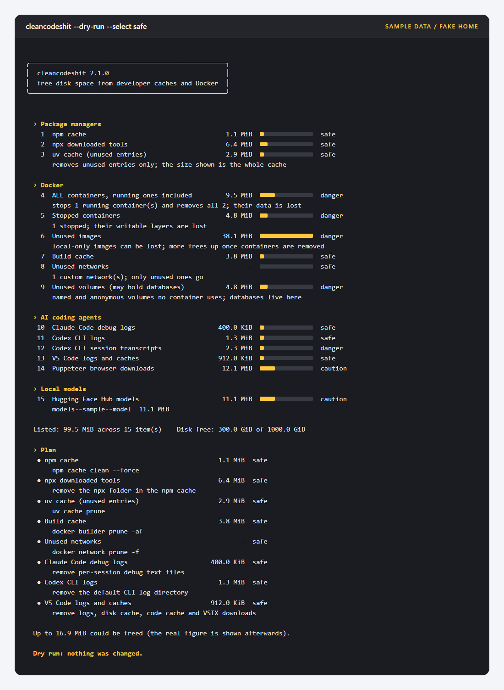

<picture>
  <source media="(prefers-color-scheme: dark)" srcset="assets/brand/logo-dark.svg" />
  <source media="(prefers-color-scheme: light)" srcset="assets/brand/logo-light.svg" />
  
</picture>

# Clean Code Shit

Clean Code Shit is a local command for macOS and Linux that scans developer caches, Docker disk usage, browser downloads, model caches, and AI agent logs. It shows what each item uses and what it would do, then removes only the lines you confirm. Version 1.1.0 is the first public release; 1.0.0 was private.



*Sample output made with fake data. Your sizes and available items will differ. No real home directory was scanned for this image.*

## What it is, and why

Package managers, build tools, browsers, AI agents, and Docker quietly fill a disk with rebuildable files. An npx or uv launch can cache another MCP server, a browser test can fetch Chromium, and a throwaway checkout can leave a full dependency tree behind.

Clean Code Shit does the boring part for you:

- Scans known locations and reports real sizes with a risk badge on every item.
- Skips items whose tool or folder is absent, and lists what it skipped.
- Asks you to choose items, shows a plan, then cleans one item at a time with a live progress line.
- Scans again and reports what was actually freed, per item.
- Writes a private log for every cleaning run.

`--list` and `--dry-run` never change anything. Normal cleanup asks for confirmation. Danger items always require the word `yes` typed in full.

## Install

Download the three files from the [v1.2.0 release](https://github.com/bankerneel/cleancodeshit/releases/tag/v1.2.0) into one directory: `cleancodeshit`, `cleancodeshit.sha256`, and `install.sh`. Keep them together, then check the checksum before running anything.

```sh
# Linux
sha256sum -c cleancodeshit.sha256

# macOS
shasum -a 256 -c cleancodeshit.sha256
```

Both should print `cleancodeshit: OK`. Then install:

```sh
bash install.sh
```

The installer puts `cleancodeshit` in `~/.local/bin`. Add that directory to your PATH if it is not there already:

```sh
export PATH="$HOME/.local/bin:$PATH"
```

Requirements: macOS or Linux, bash 3.2 or newer (the stock macOS bash is fine), and no root. The command refuses to run as root because it cleans the caches of the user who runs it. Tools that are not installed are simply skipped, so there is nothing else to set up.

To uninstall a manual installation, remove `~/.local/bin/cleancodeshit` and delete the run logs if you no longer need them. [Homebrew tap publishing and uninstall](packaging/homebrew/README.md).

## Usage

```sh
cleancodeshit                          # scan, choose, confirm, clean, report
cleancodeshit --list                   # audit only, changes nothing
cleancodeshit --dry-run --select safe  # preview selected items
cleancodeshit --select "npm uv dk_build"
cleancodeshit --select safe --yes      # unattended, safe items only
cleancodeshit --in ~/Projects --older-than 45
```

Pick items by number, range (`5-7`), name (`npm,uv,dk_build`), or preset. Separate tokens with spaces or commas. Presets are `safe` (every safe item) and `all` (every safe and caution item). Type `q` at the picker to quit. Danger items and stale folders are never in a preset.

`--in DIR` adds stale project folders under `DIR` to the audit. Choose a directory inside your home. For Git projects, start at the repository root or higher so tracked files can be checked. `--older-than DAYS` sets the inactivity threshold, 30 days by default. Select `stale` to include the listed dependency, build and cache folders in a plan.

For scripts and cron, use `--select ITEMS --yes`. `--yes` skips prompts but refuses danger items, so a typo cannot wipe a volume without a human present. Without a terminal, `--select` is required.

Other flags: `--no-color` (also `NO_COLOR=1`), `--ascii` (also `CLEANCODESHIT_ASCII=1`), `-h` / `--help`, and `-V` / `--version`.

## Items

Every ID, exact path, action, and official source is listed in [docs/items.md](docs/items.md).

| Group | ID | Clears | Risk | Path or Docker target |
| --- | --- | --- | --- | --- |
| Package managers | `npm` | npm cache | safe | `$(npm config get cache)/_cacache`, default `~/.npm/_cacache` |
| Package managers | `npx` | downloaded npx tools | safe | `$(npm config get cache)/_npx` |
| Package managers | `pnpm` | unused packages in the store | safe | `${PNPM_HOME:-$XDG_DATA_HOME/pnpm}/store/v*` on Linux, `${PNPM_HOME:-$HOME/Library/pnpm}/store/v*` on macOS |
| Package managers | `yarn` | Yarn cache | safe | macOS `~/Library/Caches/Yarn`. Linux `$XDG_CACHE_HOME/yarn`, default `~/.cache/yarn`; `YARN_CACHE_FOLDER` overrides the root |
| Package managers | `bun` | bun install cache | safe | `~/.bun/install/cache` |
| Package managers | `uv` | unused uv cache entries | safe | `${UV_CACHE_DIR:-$XDG_CACHE_HOME/uv}` |
| Package managers | `pip` | pip download cache | safe | macOS `~/Library/Caches/pip`. Linux `$XDG_CACHE_HOME/pip`, default `~/.cache/pip` |
| Package managers | `brew` | Homebrew downloads and old versions | caution | `HOMEBREW_CACHE` or `~/Library/Caches/Homebrew` on macOS, `${XDG_CACHE_HOME:-$HOME/.cache}/Homebrew` on Linux |
| Build and tool caches | `xcode` | Xcode DerivedData | safe | `~/Library/Developer/Xcode/DerivedData` |
| Build and tool caches | `playwright` | downloaded Playwright browsers | caution | macOS `~/Library/Caches/ms-playwright`. Linux `$XDG_CACHE_HOME/ms-playwright` |
| Build and tool caches | `electron` | Electron and electron-builder downloads | safe | macOS `~/Library/Caches/electron` and `~/Library/Caches/electron-builder`. Linux `$XDG_CACHE_HOME/electron` and `$XDG_CACHE_HOME/electron-builder` |
| Build and tool caches | `nodegyp` | node-gyp headers | safe | macOS `~/Library/Caches/node-gyp`. Linux `$XDG_CACHE_HOME/node-gyp` |
| Build and tool caches | `typescript` | TypeScript incremental type cache | safe | macOS `~/Library/Caches/typescript` and Linux `$XDG_CACHE_HOME/typescript` (default `~/.cache/typescript`) |
| Build and tool caches | `go` | Go build cache | safe | `GOCACHE` or `go-build` under the platform cache root |
| Build and tool caches | `cargo` | Cargo crate downloads | safe | `~/.cargo/registry/cache` |
| Build and tool caches | `cocoapods` | CocoaPods cache | safe | macOS `~/Library/Caches/CocoaPods` on macOS only |
| Build and tool caches | `gradle` | Gradle caches | caution | `~/.gradle/caches`, or `$GRADLE_USER_HOME/caches` when set |
| Build and tool caches | `precommit` | pre-commit environments | safe | `$PRE_COMMIT_HOME` or `${XDG_CACHE_HOME:-$HOME/.cache}/pre-commit` |
| Docker | `dk_all` | all containers, including running ones | danger | All containers, running ones included |
| Docker | `dk_stopped` | stopped containers | danger | Stopped containers |
| Docker | `dk_custom` | images matching your configured patterns | danger | Tagged images whose repository or repository:tag matches a configured pattern |
| Docker | `dk_images` | unused images | danger | Unused images |
| Docker | `dk_build` | build cache | safe | Build cache |
| Docker | `dk_net` | unused custom networks | safe | Unused custom networks |
| Docker | `dk_volumes` | unused volumes, which may hold databases | danger | Unused named and anonymous volumes |
| AI coding agents | `vscode` | VS Code logs and caches | safe | Linux `${XDG_CONFIG_HOME:-$HOME/.config}/Code/logs`, `CachedData`, `Cache`, `CachedExtensionVSIXs`. MacOS `$HOME/Library/Application Support/Code/` with the same subfolders |
| AI coding agents | `cursor` | Cursor logs and caches on macOS | safe | macOS `$HOME/Library/Application Support/Cursor/logs`, `CachedData`, `Cache`, `Code Cache`, `GPUCache`, `CachedExtensionVSIXs` |
| AI coding agents | `windsurf` | Windsurf and Devin Desktop logs and crash dumps | safe | `Windsurf/{logs,crashpad}` and `Devin/{logs,crashpad}` under `~/Library/Application Support` on macOS or the XDG config root on Linux |
| AI coding agents | `claude_debug` | Claude Code debug logs | safe | `${CLAUDE_CONFIG_DIR:-$HOME/.claude}/debug`; `CLAUDE_CODE_DEBUG_LOGS_DIR` can point to one in-home file with a session UUID or `claude-debug` log name |
| AI coding agents | `claude_history` | Claude Code session transcripts | danger | `${CLAUDE_CONFIG_DIR:-$HOME/.claude}/projects/<project>/*.jsonl` |
| AI coding agents | `codex_logs` | Codex CLI logs | safe | `${CODEX_HOME:-$HOME/.codex}/log` |
| AI coding agents | `codex_history` | Codex rollout and history files | danger | `${CODEX_HOME:-$HOME/.codex}/sessions/YYYY/MM/DD/rollout-*.jsonl`, `${CODEX_HOME:-$HOME/.codex}/archived_sessions/rollout-*.jsonl`, and `${CODEX_HOME:-$HOME/.codex}/history.jsonl` |
| AI coding agents | `gemini_history` | Gemini CLI chat transcripts | danger | `${GEMINI_CLI_HOME:-$HOME}/.gemini/tmp/<project>/chats/session-*.json` and `session-*.jsonl` |
| AI coding agents | `copilot_logs` | GitHub Copilot CLI logs | safe | `${COPILOT_HOME:-$HOME/.copilot}/logs` |
| AI coding agents | `opencode_logs` | OpenCode logs | safe | `${XDG_DATA_HOME:-$HOME/.local/share}/opencode/log` |
| AI coding agents | `puppeteer` | downloaded Puppeteer browsers | caution | `${PUPPETEER_CACHE_DIR:-$HOME/.cache/puppeteer}/{chrome,chrome-headless-shell,chromium,firefox}` |
| Local models | `hf_hub` | Hugging Face model repos | caution | `HF_HUB_CACHE`, then legacy `HUGGINGFACE_HUB_CACHE`, then `$HF_HOME/hub`, then `${XDG_CACHE_HOME:-$HOME/.cache}/huggingface/hub` |
| Local models | `ollama` | Ollama manifests and blobs | caution | `${OLLAMA_MODELS:-$HOME/.ollama/models}` with `manifests/`, `manifests-v2/` and `blobs/`. The resolved path must stay inside HOME |
| Local models | `torch_hub` | PyTorch Hub downloads | caution | `$TORCH_HOME/hub` or `${XDG_CACHE_HOME:-$HOME/.cache}/torch/hub` |
| Local models | `lm_studio` | LM Studio GGUF models | caution | `$HOME/.lmstudio/models/<publisher>/<model>/*.gguf` |
| Projects | `stale` | generated folders under `--in` past the inactivity threshold | caution | `node_modules`, `.venv`, `venv`, `target`, `.next`, `dist`, `build`, `.turbo`, or `.parcel-cache` under the selected root |

## Risk levels

- **safe**: a cache the tool rebuilds or re-downloads on demand. Removing it costs time at worst.
- **caution**: re-download is slow or large, or the item removes old versions. It is listed apart from safe items and never removed by a `safe` preset.
- **danger**: data can be lost. A plan with a danger item asks you to type `yes`, and `--yes` refuses it. Examples include session transcripts, containers, local images and unused volumes.

## Paths

The tool resolves filesystem cleanup paths inside the current user’s home directory:

| Variable | Default | Used for |
| --- | --- | --- |
| `$HOME` | login home | most user caches and model stores |
| `XDG_CACHE_HOME` | `~/.cache` | Linux build and tool caches |
| `XDG_CONFIG_HOME` | `~/.config` | config roots, including `dk_custom` |
| `XDG_DATA_HOME` | `~/.local/share` | OpenCode logs |
| `XDG_STATE_HOME` | `~/.local/state` | private run logs on Linux |
| macOS Caches | `~/Library/Caches` | package and build caches |
| macOS Logs | `~/Library/Logs/cleancodeshit` | private run logs |

Docker items go through the Docker CLI rather than filesystem paths. `dk_custom` reads image patterns from `CLEANCODESHIT_DOCKER_IMAGES`, or from the `docker_images=` key in `$XDG_CONFIG_HOME/cleancodeshit/config`. See [docs/items.md](docs/items.md) for the exact path of every item and its override.

## Safety

- Every filesystem path must stay inside your home directory, with no traversal, no symlink components, and no `.git` directories.
- Deletions are confined to the listed cache and log paths. Your projects, settings, and credentials are not touched.
- `--list` and `--dry-run` never delete. A normal run shows the plan and waits for you.
- Danger items need the full word `yes`. Presets and `--yes` cannot select them, and stale folders are never in a preset.
- Runs write a private log (`~/Library/Logs/cleancodeshit` on macOS, `$XDG_STATE_HOME/cleancodeshit` on Linux). The last 20 logs are kept when the log directory is inside HOME.
- Ctrl+C stops the active cleanup process group and skips remaining items. Docker operations already accepted by the daemon can continue. Already cleaned items stay cleaned, and the log path is printed.
- Docker queries use the context selected at scan time. Ollama model details come from a local server when available.

## FAQ

**Does it delete my projects?** No. Only the paths in the item table are removed. Stale project folders are opt-in through `--in`, confirmed separately, and excluded from presets.

**Will I lose my AI conversations?** Only if you deliberately choose a history item and type `yes`. Session transcripts and editor local history are distinct from the log and debug targets. Keep older logs if you still need them for troubleshooting.

**An item is missing from the table. Why?** The tool is not installed, or there was nothing to clean. Missing items are listed at the end of the audit. Docker items are hidden when the daemon is not running.

**Can I run it unattended?** Yes, with `--select ITEMS --yes`. Danger items are refused in that mode by design.

**Where is the log?** `~/Library/Logs/cleancodeshit` on macOS and `$XDG_STATE_HOME/cleancodeshit` on Linux, with a timestamped file per cleaning run.

**Which Docker endpoint does it use?** The scan uses your configured Docker context or host and carries that selection into cleanup.

## Windows next

Version 1.2.0 supports macOS and Linux. Windows support is next, including Windows cache paths, file safety checks, and a native installer.

## Links

- [Item paths and sources](docs/items.md)
- [Changelog](CHANGELOG.md)
- [Contributing](CONTRIBUTING.md)
- [Security policy](SECURITY.md)
- [License](LICENSE)

Released under the MIT License. Copyright (c) 2026 Neel Banker.
